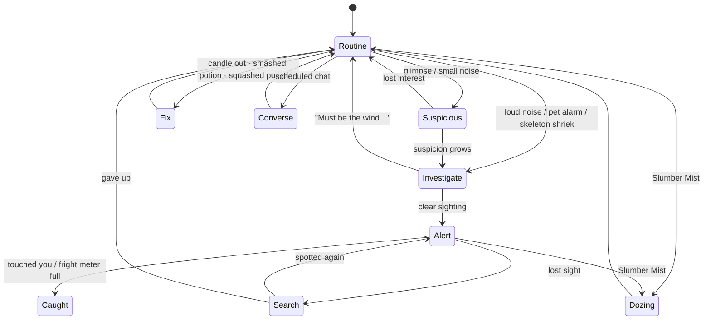
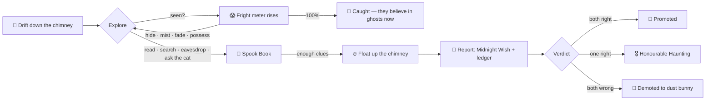
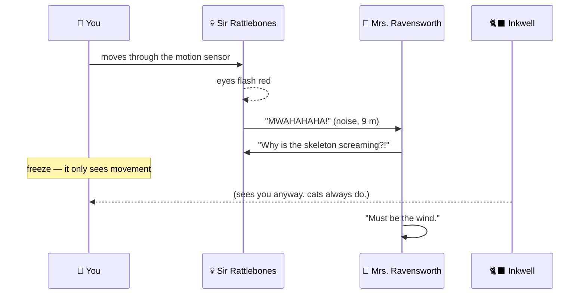

<p align="center">
  <a href="https://echoness.itch.io/the-order-of-boo"></a>
</p>

<h1 align="center">🎃 The Order of B.O.O. 👻</h1>
<p align="center"><b>B</b>oos <b>O</b>bserving <b>O</b>minously · a spooky-cosy Halloween stealth immersive sim for the browser</p>

<p align="center">
  <a href="https://echoness.itch.io/the-order-of-boo"></a>
  <a href="https://e-choness.github.io/the-order-of-boo/"></a>
  <a href="media-kit/"></a>
</p>

<p align="center">
  <a href="https://github.com/e-choness/the-order-of-boo/stargazers"></a>
  <a href="https://github.com/e-choness/the-order-of-boo/commits"></a>
  <a href="https://github.com/e-choness/the-order-of-boo/graphs/commit-activity"></a>
  <a href="https://github.com/e-choness/the-order-of-boo/actions/workflows/ci.yml"></a>
  <a href="https://github.com/e-choness/the-order-of-boo/actions/workflows/deploy-pages.yml"></a>
  <a href="https://github.com/e-choness/the-order-of-boo/actions/workflows/deploy-itch.yml"></a>
  <a href="https://github.com/e-choness/the-order-of-boo/releases"></a>
  
  
  <a href="LICENSE"></a>
  
</p>

<p align="center">
  
  
  
  
  
  
  
  
</p>

<!-- haunt:start -->
<p align="center">
  
  
  
</p>

| 🔮 Haunting forecast for 2026-10-30 | |
| --- | --- |
| Moon | 🌖 Waning gibbous |
| Weather | 🦇 Bats on the move |
| Household cats | asleep (for now) |
| Candy supply | plentiful |
<!-- haunt:end -->

<p align="center"><sub>☝️ refreshed every night at 00:13 UTC by <a href=".github/workflows/haunt-forecast.yml">a GitHub Action</a> — countdown, real moon phase, and a forecast no meteorologist would sign.</sub></p>

<p align="center">
  
  
</p>

> Every Halloween, children whisper a secret **Midnight Wish** to the dark — and the wish gets muddled
> by sugar, siblings and misspelled letters. The **Order of B.O.O.**, a secret society of small, very
> polite bedsheet ghosts, drifts down chimneys to find out the truth. Sneak past parents in costume,
> cats who can *see* spirits, dogs who can *smell* them and motion-sensor skeletons who **shriek** —
> then decide whether the child goes in **Old Jack o' the Lantern's Treat ledger** 🍬 or the
> **Bogeyman's Trick book** 🕷️.

<!-- tip:start -->
> 🕯️ **Boo field tip of the day:** A puff of Slumber Mist hides you as well as sending people to dreamland.
<!-- tip:end -->

## 🎮 Play

| | |
| --- | --- |
| **itch.io** | **[echoness.itch.io/the-order-of-boo](https://echoness.itch.io/the-order-of-boo)** — free, runs in your browser |
| **GitHub Pages** | **[e-choness.github.io/the-order-of-boo](https://e-choness.github.io/the-order-of-boo/)** — same build, deployed on every push to `main` |
| **Run locally** | `npm install && npm run dev` → <http://localhost:5173> |

Desktop browser with keyboard & mouse. Best with headphones 🎧 — and the lights off 🕯️.

## ✨ Features

<table>
<tr>
<td width="50%" valign="top">

**🕯️ Light & shadow stealth** — a live glow gauge samples every lamp, candle, jack-o'-lantern, the
fire, torch beams and moonbeams through the windows. **Snuff** a candle from across the room… and watch
someone grumble and light it again.

**👂 Sound that travels** — carpet muffles, tile clatters, floorboards creak (even under ghosts), potion
bottles shatter and pumpkins go *splat*; walls and closed doors dampen it all.

**🧠 A household with a Halloween routine** — carving pumpkins, monster-movie marathons, answering the
door to trick-or-treaters, gossiping about the kids. Suspicion → investigation → chase → search.

**🐈‍⬛ Creatures with rules** — cats **see spirits** (Fade won't fool them), dogs **smell** ghosts,
animatronic lawn skeletons only see **movement** and shriek for the humans. Make friends with treats.

</td>
<td width="50%" valign="top">

**👻 Boo magic** — Fade, Possess (hop into a jack-o'-lantern), Spirit Sight (see through a skull's eyes),
Bump in the Night (a knocking will-o'-wisp), Snuff, and Slumber Mist.

**🧰 Imsim toolkit** — hide in wardrobes, under beds, behind curtains, in pumpkin piles or a cardboard
box; throw books, potions and pumpkins; climb furniture; sneak sweets from the candy bowl.

**🕵️ Deduction** — wishes, deeds and rumours, with decoys that only careful reading exposes: the date on
a certificate, a P.S. addressed to Mum, a "Hazel" letter with suspiciously perfect spelling.

**🎨 Polished spooky rendering** — harvest moon, drifting clouds, falling leaves, ground fog, bats,
guttering candlelight, portraits whose eyes follow you, AO + bloom + custom grading.

</td>
</tr>
</table>

### 🧪 Why it's fun (the immersive-sim recipe)

- **Systems, not scripts.** Every tool touches every other system. Snuffing a lamp makes a shadow *and*
  a reason for someone to walk over — which empties the room you actually wanted.
- **Your plan, your style.** Ghost it perfectly, mist the whole family to sleep, or befriend the cat and
  let her gossip for you. Medals reward each play style (🌫️ Truly Invisible, 🕊️ Rest in Peace, 🍬 Sweet Tooth…).
- **The house is a puzzle box.** Routines repeat, conversations recur if you miss them, clues hide in
  drawers, phones, bins and sleep-talk. Second runs are faster, sneakier and funnier.
- **Kind stakes.** Nobody gets hurt. The worst outcome? *"The Hollowells now believe in ghosts."*

## 🖼️ Screenshots

| | | |
| --- | --- | --- |
|  |  |  |
|  |  |  |
|  |  |  |

More in the **[media kit](media-kit/)** — logos, key art, banners, icons, GIFs, a fact sheet and store copy.

## 🗺️ Missions

| # | House | Child | Twist |
| --- | --- | --- | --- |
| 0 | **Ghost School: Midnight Drill** | Mabel Make-Believe, 8 *(pretend)* | Guided training against Sergeant Rattlebones, a clockwork skeleton drill instructor |
| 1 | **The Hollowell House** | Wren, 9 | The big letter on the fridge is a decoy — and Mothball the cat gossips |
| 2 | **Thornbury Farmhouse** | Otto, 11 | The kid is awake and laying ghost traps; Granny patrols with a torch; the dog smells Boos |
| 3 | **Ravensworth Manor** | Hazel, 7 | Party aftermath: a teen on the phone, a dozing mummy, motion-sensor lights and two shrieking skeletons |

## 📖 Spell book

| Spell | Key | What it does | Watch out for |
| --- | --- | --- | --- |
| 🌫️ **Slumber Mist** | `LMB` | Violet puff: people doze off, leaves a hiding cloud | Three puffs, slow refill |
| 👻 **Fade** | `1`/`2` | 6 s of see-through invisibility | Cats see spirits; dogs smell you; you still make noise |
| 🎃 **Possess** | `1`/`2` | Become a jack-o'-lantern — undetectable while still | Moving pops you out; no ecto regen |
| 👁️ **Spirit Sight** | `1`/`2` | Look through a skull / crow / cat statue; tag people with `F` | Your body stays where you left it |
| 🦇 **Bump in the Night** | `1`/`2` | Toss a will-o'-wisp that knocks and rattles | Everyone nearby comes to look — including where you are |
| 🕯️ **Snuff** | `1`/`2` | Blow out any light you can see, up to 12 m | People notice dark rooms and relight what they care about |

## ⌨️ Controls

| Key | Action | Key | Action |
| --- | --- | --- | --- |
| `W A S D` | Move | `E` | Interact · hide · hold to search |
| `Mouse` | Look | `Left click` | Slumber Mist / throw held item |
| `Shift` | Sprint (loud) | `Right click` | Drop held item |
| `Q` / `C` | Crouch | `1` `2` | Cast spells |
| `Space` | Jump / climb | `F` | Tag a person (Spirit Sight) |
| `Tab` / `Esc` | Spook Book & pause | `3` | Report (all clues found) |

<details>
<summary><b>🧠 How the household thinks</b> (NPC state machine)</summary>



</details>

<details>
<summary><b>🔁 The haunting loop</b></summary>



</details>

<details>
<summary><b>🦴 What happens when you walk in front of a lawn skeleton</b></summary>



</details>

<details>
<summary><b>🛠️ Tech stack & project layout</b></summary>

| Layer | What |
| --- | --- |
| Rendering | three.js · pmndrs postprocessing (N8AO, mip bloom, SMAA, AgX) · custom grading pass (fright, mist, spell states) |
| World | procedural house builder, Kenney CC0 props, **procedural Halloween props** (pumpkins, gravestones, cauldrons, scarecrows, cobwebs…), canvas textures |
| Sky & FX | shader sky with harvest moon, clouds & spirit ribbons · GPU leaf fall · noise ground fog · bats · particle wisps |
| AI | grid A* with string-pulling, perception (sight / hearing / smell / spirit sight / motion), routines & conversations |
| Audio | Web Audio: HRTF sound effects, live-synthesised Chopin / Grieg / Bach that react to tension, synthesised shrieks & knocks |
| UI | DOM + CSS (candlelit glass HUD), Creepster / Fraunces / Nunito / Caveat / Special Elite fonts |
| Tooling | Node 26, Vite 8, TypeScript 7 (strict), level validator at `/#validate`, Playwright-driven media kit |

```
src/            ← game code: core · world · game · ui · levels · dev
public/assets/  ← Kenney CC0 models, textures, audio (+ licence files)
media-kit/      ← press kit: screenshots, logos, art, GIFs, fact sheet, store copy + the tools that render it
docs/           ← development guide
.github/        ← CI, GitHub Pages deploy, itch.io deploy, releases, the nightly haunting forecast
```

Developer guide: **[docs/DEVELOPMENT.md](docs/DEVELOPMENT.md)**.

</details>

## 🚀 Releases & deployment

Every push to `main` is built and shipped to **[GitHub Pages](https://e-choness.github.io/the-order-of-boo/)** and
**[itch.io](https://echoness.itch.io/the-order-of-boo)** by GitHub Actions (itch.io via
[butler](https://itch.io/docs/butler/)); tagging `v*` also publishes a
[GitHub Release](https://github.com/e-choness/the-order-of-boo/releases) with a ready-to-host zip.
Setup and details: [docs/DEVELOPMENT.md](docs/DEVELOPMENT.md#deploying).

## 🙌 Credits

**Design & code** — Echo (Beili) Yin

**Assets** — 3D models, particles, sound effects and jingles by [Kenney](https://kenney.nl) (CC0) ·
Halloween props, sky and effects generated in code · music: Chopin, Grieg and Bach (public domain),
arranged live · fonts under the SIL Open Font License.

## 📜 License

**Non-commercial.** The game's code and original content are licensed under the
[PolyForm Noncommercial License 1.0.0](LICENSE): play it, fork it, learn from it, mod it, share it —
just don't sell it or use it commercially. Kenney assets are CC0 (licence files in
[`public/assets/licenses`](public/assets/licenses)); fonts are OFL.

<p align="center"><sub>Made with 🎃, 🕯️ and a suspicious amount of candy corn. No raisins were harmed.</sub></p>
