<p align="center">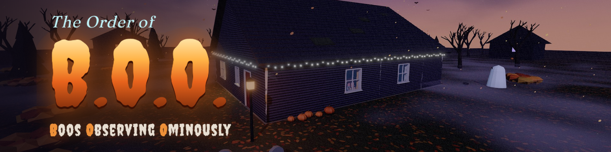</p>

# 📰 The Order of B.O.O. — Media kit

Everything you need to write about, stream or feature **The Order of B.O.O.** Free to use for coverage,
previews, videos and articles (non-commercial use of the game itself is covered by the project
[licence](../LICENSE)). Please don't alter the logo.

[](https://echoness.itch.io/the-order-of-boo)
[](https://e-choness.github.io/the-order-of-boo/)

## 🗂️ Fact sheet

| | |
| --- | --- |
| **Title** | The Order of B.O.O. — *Boos Observing Ominously* |
| **Genre** | First-person stealth immersive sim · cosy-spooky · deduction |
| **Platform** | Web browser (desktop, keyboard & mouse) — WebGL 2 |
| **Price** | Free · non-commercial |
| **Developer** | Echo (Beili) Yin |
| **Release** | Halloween 2026 |
| **Play time** | ~45–90 minutes for all four missions; replayable for stars and medals |
| **Languages** | English |
| **Tech** | three.js, pmndrs postprocessing, Web Audio, TypeScript, Vite |
| **Links** | [itch.io](https://echoness.itch.io/the-order-of-boo) · [GitHub Pages](https://e-choness.github.io/the-order-of-boo/) · [Source](https://github.com/e-choness/the-order-of-boo) |

## 📝 Descriptions

**One line (≈100 chars)**
> A cosy-spooky stealth sim: sneak through homes on Halloween night as a polite little bedsheet ghost.

**Short (≈300 chars)**
> Every Halloween a child whispers a secret Midnight Wish. As an agent of the Order of B.O.O., drift
> down the chimney, dodge costumed parents, ghost-sensing cats and shrieking lawn skeletons, gather the
> clues — and decide: Treat or Trick? Free in your browser.

**Long**
> **The Order of B.O.O.** is a first-person stealth immersive sim set on Halloween night. You are a
> small, very polite bedsheet ghost of a secret society whose job is to find out what each child
> *really* wishes for — and whether they have earned a Treat from Old Jack o' the Lantern or a
> (harmless, memorable) Trick from the Bogeyman.
>
> Every house is a living system. Families carve pumpkins, binge monster movies and answer the door to
> trick-or-treaters. Light and sound are simulated: snuff a candle to make a shadow and someone will
> wander over to relight it; drop a potion and the shatter brings the whole household. Cats can see
> spirits, dogs can smell them, and motion-sensor skeletons shriek the moment you move.
>
> Your toolkit is yours to combine: Fade into invisibility, Possess a jack-o'-lantern, borrow a skull's
> eyes with Spirit Sight, lure people with a knocking will-o'-wisp, Snuff lights from across the room, or
> send someone to dreamland with a puff of Slumber Mist. Read diaries, phone screens and receipts,
> eavesdrop on gossip, befriend the cat — and watch for decoys: the obvious wish is rarely the true one.

## ✨ Key features

- 🕯️ Light-and-shadow stealth with a live glow gauge — every lamp, candle and jack-o'-lantern counts
- 👂 Simulated sound: carpet vs tile, creaky floorboards, shattering potions, splatting pumpkins
- 🐈‍⬛ Creatures with rules: cats see ghosts, dogs smell them, animatronic skeletons see only movement
- 👻 Six combinable spells, including **Possess** (become a jack-o'-lantern) and **Snuff** (remote candle-blowing)
- 🔎 Deduction with in-world writing and carefully planted decoys
- 🏚️ Four handcrafted houses with costumed families, routines and recurring conversations
- 🎻 Public-domain classics (Chopin, Grieg, Bach) performed live by a Web Audio engine that speeds up when you're spotted
- 🌕 Harvest-moon sky, drifting clouds, falling leaves, ground fog, bats — all in the browser

## 🖼️ Screenshots (1920×1080)

| | |
| --- | --- |
| 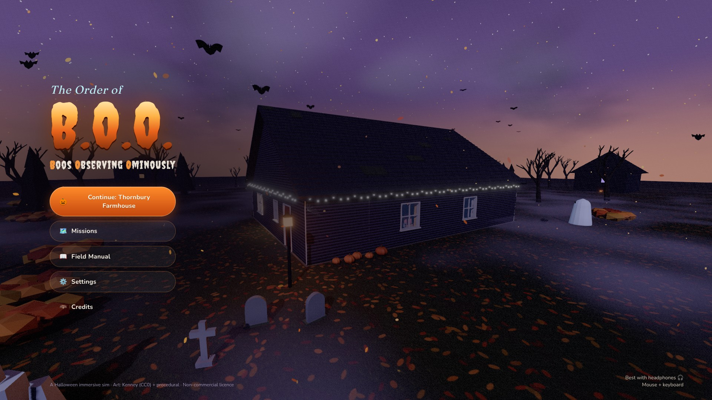 **01** Title — the Hollowell house under a harvest moon | 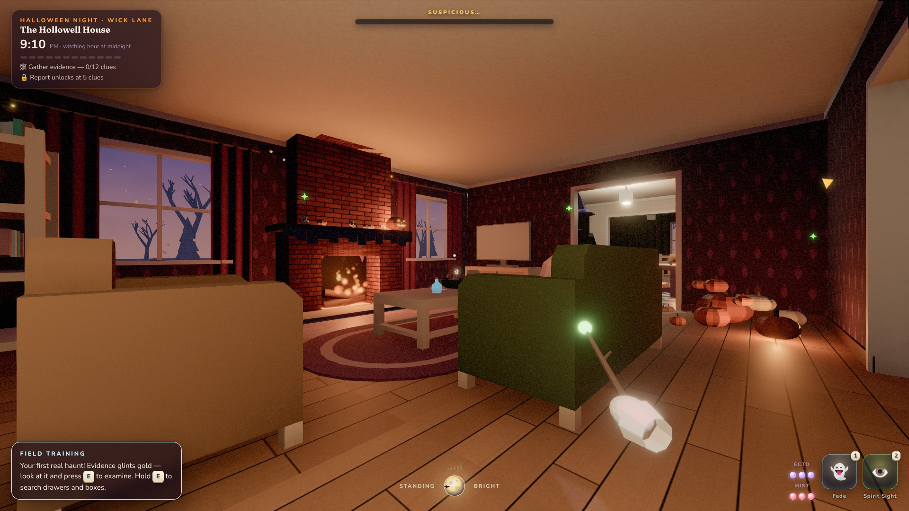 **02** The Hollowell living room |
| 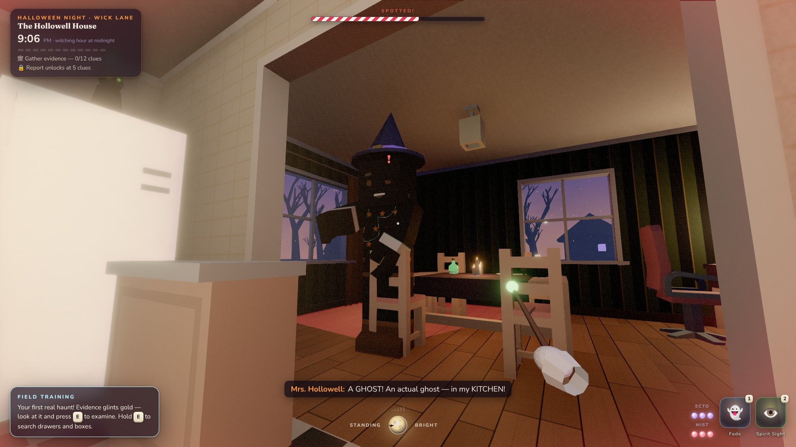 **03** Spotted! | 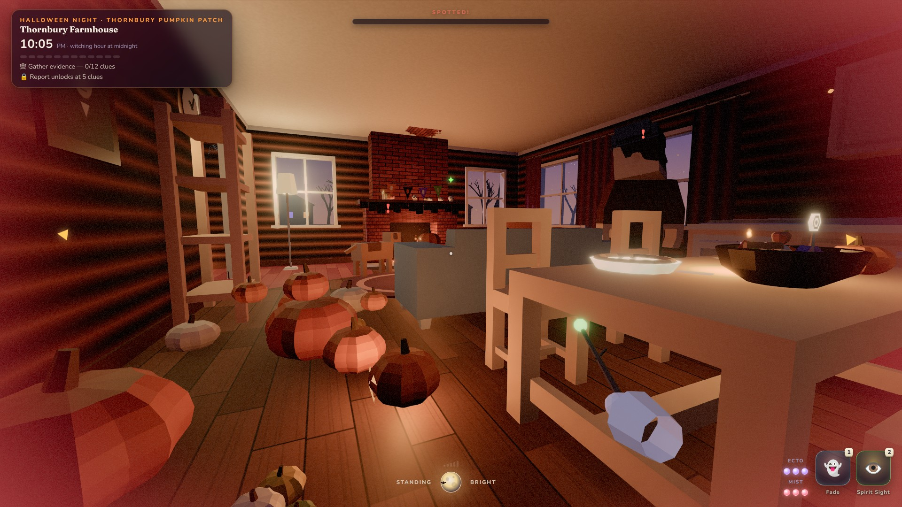 **04** Thornbury Farmhouse |
| 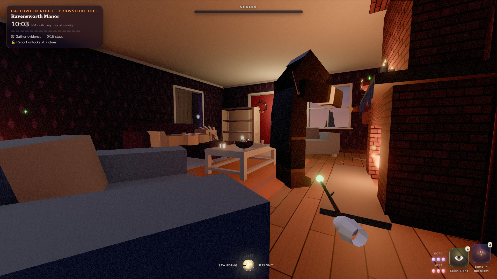 **05** Ravensworth Manor, the morning-after party | 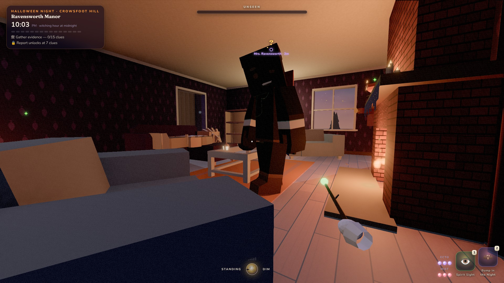 **06** Spirit Sight through a crow's eyes |
| 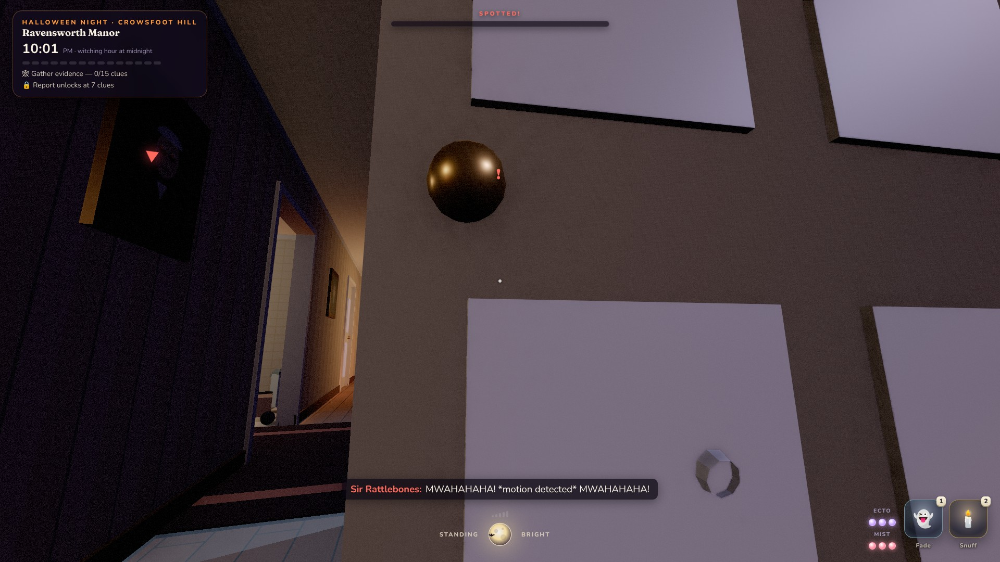 **07** A motion-sensor skeleton shrieks | 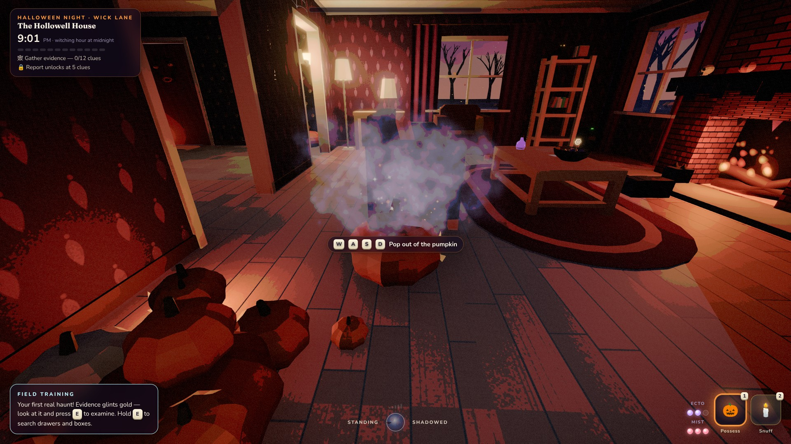 **08** Possessing a jack-o'-lantern |
| 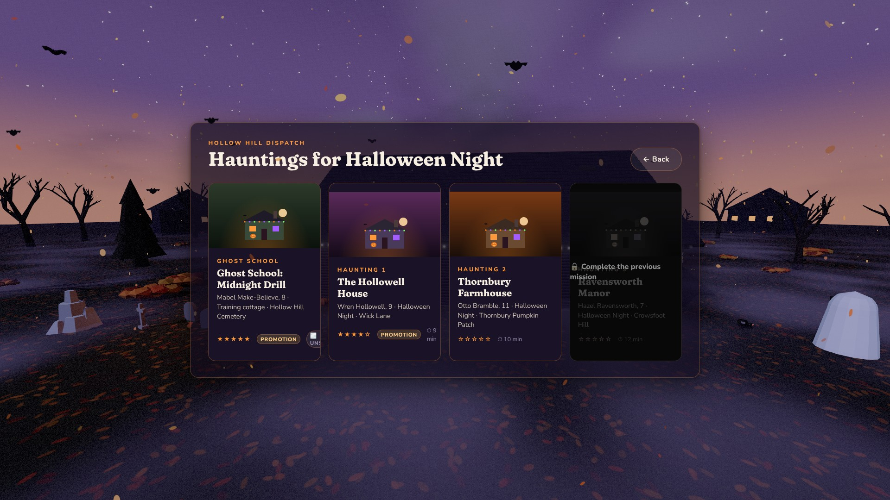 **09** Haunting select | 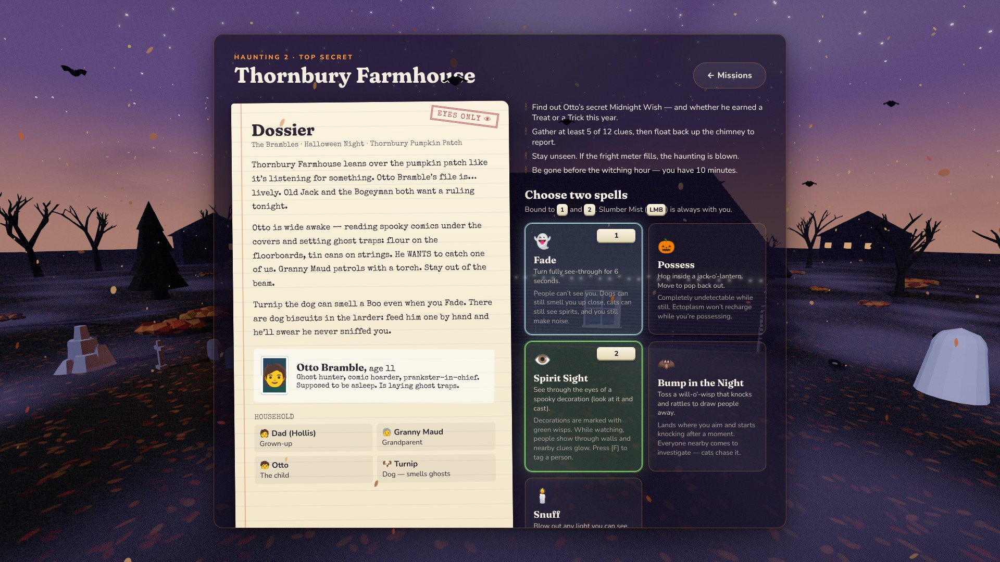 **10** Briefing & spell loadout |
| 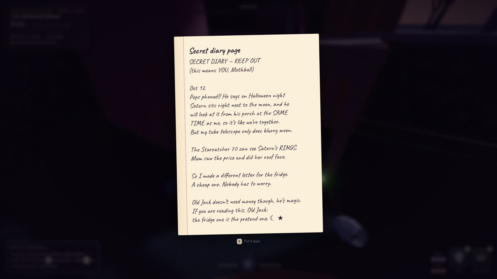 **11** Reading a diary | 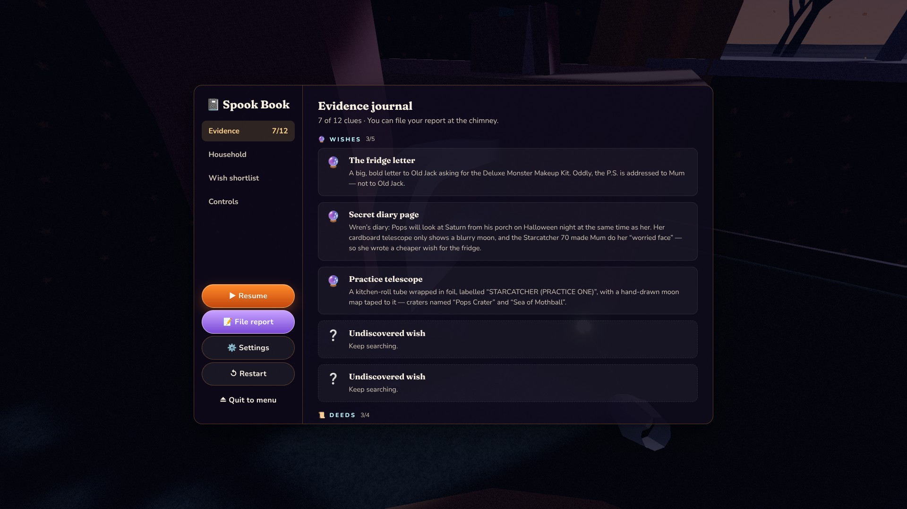 **12** The Spook Book (journal) |
| 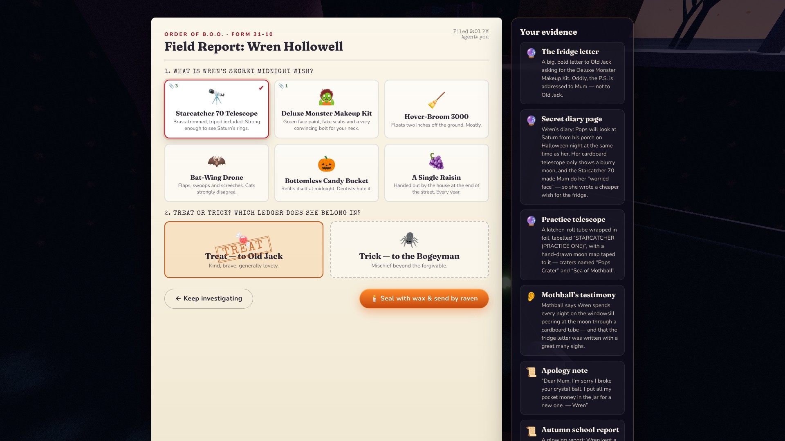 **13** Filing the report: wish + Treat or Trick | 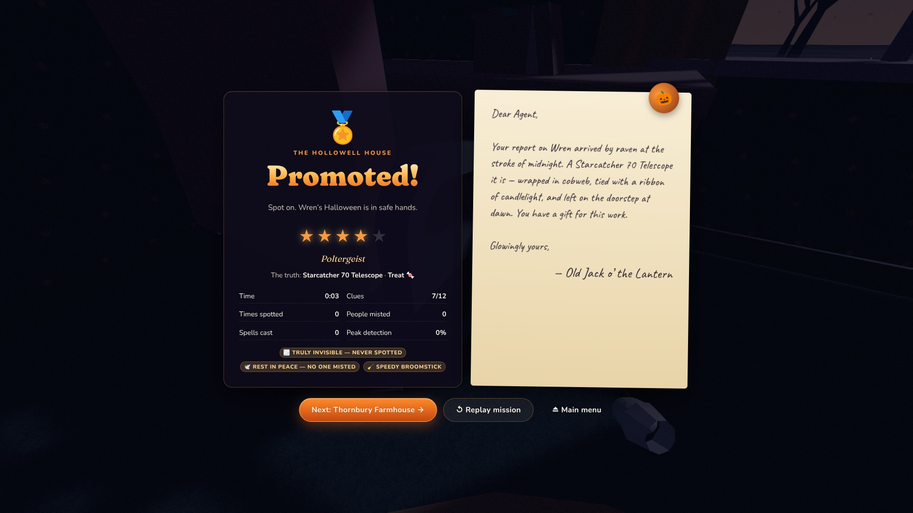 **14** Results & letter from Old Jack |

## 🎞️ GIFs

| | |
| --- | --- |
| 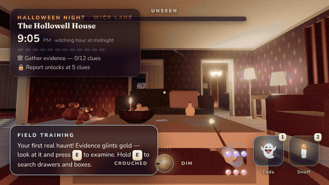 `gif/sneaking.gif` | 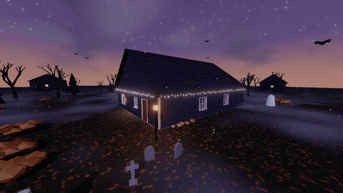 `gif/haunted-house-orbit.gif` |

## 🎨 Logos, icons & art

| File | Use |
| --- | --- |
| [`logo/logo-transparent.png`](logo/logo-transparent.png) | Logo on transparent background (for dark surfaces) |
| [`logo/logo-on-night.png`](logo/logo-on-night.png) | Logo on the night-violet background |
| [`logo/icon-512.png`](logo/icon-512.png) · [256](logo/icon-256.png) · [128](logo/icon-128.png) · [64](logo/icon-64.png) | App / avatar icons |
| [`art/keyart-clean.jpg`](art/keyart-clean.jpg) | Key art without UI (1920×1080) |
| [`art/fireplace-clean.jpg`](art/fireplace-clean.jpg) | Interior key art without UI (1920×1080) |
| [`art/wallpaper-1920x1080.png`](art/wallpaper-1920x1080.png) · [`art/wallpaper-fireplace-1920x1080.png`](art/wallpaper-fireplace-1920x1080.png) | Desktop wallpapers |
| [`art/banner-1920x480.png`](art/banner-1920x480.png) | Wide header / banner |
| [`art/github-social-1280x640.png`](art/github-social-1280x640.png) | Social preview (GitHub, Open Graph) |
| [`art/itch-cover-630x500.png`](art/itch-cover-630x500.png) | itch.io cover image |
| [`art/capsule-460x215.png`](art/capsule-460x215.png) | Small capsule |

## 🎨 Palette & type

| Swatch | Hex | Role |
| --- | --- | --- |
| 🟧 | `#E8631C` | Pumpkin (primary) |
| 🟨 | `#FFB347` | Candlelight |
| 🟪 | `#8B4BD6` | Witching violet |
| 🟩 | `#7CFF6B` | Spirit green |
| ⬛ | `#0D0914` | Night |
| 🟥 | `#9A1A2C` | Wax seal |

Type: **Creepster** (logo & display), **Fraunces** (headings), **Nunito** (UI), **Caveat** (handwriting),
**Special Elite** (dossiers) — all SIL Open Font License.

## 🛠️ Regenerating the kit

The kit is rendered from the live game, so it always matches the current build:

```bash
npm run dev &                                        # from the repo root
node media-kit/tools/capture-screenshots.mjs         # screenshots, key art, transparent logo
node media-kit/tools/capture-gif-frames.mjs sneak 60 # then encode with ffmpeg (see the script header)
node media-kit/tools/capture-gif-frames.mjs orbit 48
python3 media-kit/tools/compose-art.py               # banners, covers, icons, og-image
```

Store copy for itch.io lives in [`store-page.md`](store-page.md).
